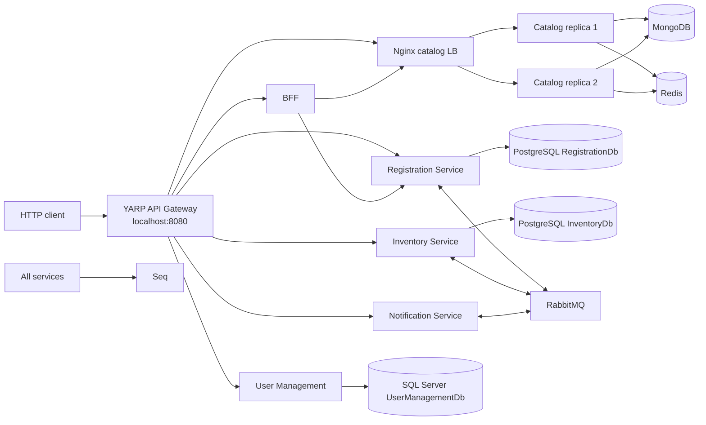
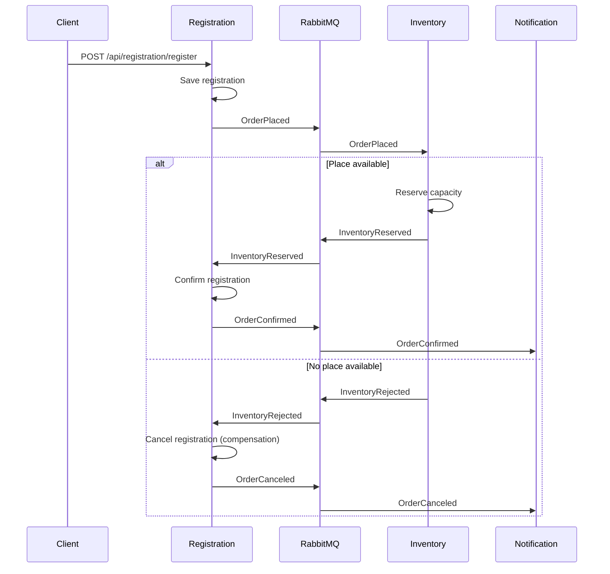

# Course_Registration_Microservices

Course_Registration_Microservices is a distributed .NET application for managing course enrollment. It demonstrates independently deployable services, private data stores, an API gateway, a BFF, asynchronous messaging, a choreography-based saga, caching, load balancing, and centralized observability.

The repository's course-registration vocabulary maps to a common order workflow:

| This project | Order-system equivalent |
| --- | --- |
| Course registration | Order |
| Course catalog | Product catalog |
| Course capacity | Inventory |
| Registration confirmation or cancellation | Final order state |
| Final registration notification | Customer notification |

## Capabilities

- User authentication with JWT, employee management, and credit management.
- Course and lecturer CRUD operations.
- Course capacity creation, reservation, and release.
- Asynchronous registration through RabbitMQ.
- Confirmation when capacity is available and compensation when it is not.
- Notifications for final registration states.
- BFF aggregation of registration and course data.
- Redis cache-aside reads for individual courses.
- Two catalog replicas behind Nginx.
- Correlation IDs through HTTP and RabbitMQ.
- Structured logs, health checks, liveness, readiness, and Swagger.

## Architecture



All containers share the private `app-network`. Clients should use the gateway; application services are not published directly by the root compose file.

## Services and data ownership

| Service | Responsibility | Data/dependencies |
| --- | --- | --- |
| `ApiGatewayService` | Public entry point and routing | YARP reverse proxy |
| `BffService` | Web-client-specific aggregation | HTTP clients for registration and catalog |
| `RegistrationService` | Registration records and saga coordination | PostgreSQL, RabbitMQ, Redis idempotency |
| `CourseCatalogService` | Courses and lecturers | MongoDB, Redis cache, two replicas |
| `InventoryService` | Capacity and reservations | PostgreSQL, RabbitMQ, Redis idempotency |
| `NotificationService` | Final-event consumer and notifications | RabbitMQ, Redis |
| `UserManagementService` | Users, employees, credits, and JWT | SQL Server |
| `Shared` | Serilog, health, request logging, and correlation middleware | Linked into the services |

Each service owns its store and accesses it only through its own code.

- **Registration PostgreSQL** uses ACID transactions for registration identity and status changes.
- **Inventory PostgreSQL** uses atomic capacity updates to prevent overselling places.
- **Catalog MongoDB** stores nested course details and supports varying attributes without a rigid shared schema.
- **User Management SQL Server** stores relational identity, employee, and credit data with EF Core migrations.
- **Redis** provides distributed key-value storage for catalog cache entries and consumer idempotency markers; it is not a source of truth.

[`ADRs.docx`](ADRs.docx) contains the database decisions. In short, relational stores favor strong consistency and ACID behavior; MongoDB and Redis are selected for flexible documents and fast distributed access, with service-specific consistency expectations and CAP tradeoffs.

## Registration saga

RabbitMQ uses a durable direct exchange named `learning`.



The incoming `X-Correlation-ID` becomes the event `CorrelationId` and RabbitMQ message property. Consumers acknowledge messages after processing and use Redis-backed idempotency support for at-least-once delivery.

## API surface

Use `http://localhost:8080` as the base URL.

### Catalog and lecturers

- `GET /api/course/coursesList`
- `GET /api/course/{id}`
- `POST /api/course`
- `PUT /api/course/{id}`
- `DELETE /api/course/{id}`
- `GET /api/lecturer/lecturersList`
- `GET /api/lecturer/{id}`
- `GET /api/lecturer/SearchLecturersByName`
- `POST /api/lecturer`
- `PUT /api/lecturer/{id}`
- `DELETE /api/lecturer/{id}`

### Inventory

- `GET /api/inventory`
- `GET /api/inventory/course/{courseId}`
- `POST /api/inventory`
- `PUT /api/inventory/capacity`
- `POST /api/inventory/reserve`
- `POST /api/inventory/release`
- `DELETE /api/inventory/{id}`

### Registration

- `GET /api/registration/{id}`
- `GET /api/registration/employee/{employeeId}`
- `GET /api/registration/course/{courseId}/registrations`
- `POST /api/registration/register`
- `PUT /api/registration/{registrationId}/status`
- `DELETE /api/registration/{registrationId}/cancel`

### Identity, employees, and notifications

- `POST /api/auth/register`, `POST /api/auth/login`
- `GET /api/user/usersList`, `GET /api/user/{id}`, `POST /api/user`, `PUT /api/user/{id}`, `DELETE /api/user/{id}`
- `GET /api/employee/employeesList`, `GET /api/employee/{id}`, `PUT /api/employee/{id}`, `DELETE /api/employee/{id}`
- `POST /api/employee/{employeeId}/addCredits`
- `POST /api/notification`, `GET /api/notification/{id}`, `GET /api/notification/user/{userId}`, `POST /api/notification/{id}/retry`

### BFF aggregation

`GET /api/bff/RegistrationDetail/{registrationId}` calls registration and catalog, then returns one client-shaped response containing registration status, course details, lecturer name, and available credits. This aggregation belongs in the BFF; the gateway remains responsible for routing.

## Health and observability

Every application exposes `/health`, `/health/live`, and `/health/ready`. Gateway routes expose checks at `/api/bff/health`, `/api/registration/health[/{catch-all}]`, `/api/course/health`, `/api/inventory/health[/{catch-all}]`, `/api/auth/health`, and `/api/notification/health`.

`src/Shared/ObservabilityExtensions.cs` configures Serilog console and rolling-file sinks, optional Seq output, `ServiceName` enrichment, correlation enrichment, request logging, and health-log filtering. Logs are mounted under each service's `logs` directory. Seq is available at `http://localhost:8081`; gateway Swagger is at `http://localhost:8080/swagger`.

## Run locally

### Prerequisites

- Docker Desktop with Docker Compose v2.
- .NET SDK compatible with the projects. Most projects target .NET 9; Notification Service targets .NET 8.
- VS Code REST Client is optional for using [`test.http`](test.http).

### Start the environment

```powershell
docker compose up --build
```

Detached mode and status checks:

```powershell
docker compose up --build -d
docker compose ps
```

Stop containers without deleting data:

```powershell
docker compose down
```

Remove development database volumes too:

```powershell
docker compose down -v
```

Important local URLs:

- Gateway: `http://localhost:8080`
- RabbitMQ management: `http://localhost:15672` (`guest` / `guest`)
- Seq: `http://localhost:8081`

Compose credentials and the JWT secret are development values. Externalize them before shared or production deployment.

## Verification guide

[`test.http`](test.http) contains a complete request collection. The basic flow is: register a user, create an employee, create a lecturer and course, create inventory, then call `POST /api/registration/register`. Query the registration and inventory afterward; the final status changes asynchronously.

### Compensation path

Set capacity to zero, or exceed available capacity, and submit another registration. In Seq, follow one correlation ID through `OrderPlaced`, `InventoryRejected`, `OrderCanceled`, and the final notification.

### Cache path

Call `GET /api/course/{id}` twice. The first request logs `Cache MISS`, reads MongoDB, and stores `course:{id}` in Redis. The next request logs `Cache HIT`. Course updates delete the key and log invalidation; the next read repopulates it with a five-minute expiry.

### Load-balancing path

Repeated catalog requests expose `X-Service-Instance`, `X-Upstream-Server`, and `X-Load-Balancer-Node`. The replicas are `catalog.api1` and `catalog.api2`:

```powershell
docker compose stop catalog.api1
docker compose logs -f catalog.lb
docker compose start catalog.api1
```

Nginx should continue serving catalog requests through the healthy replica while one is stopped.

### Correlation path

Add `X-Correlation-ID: my-saga-001` to a registration request and search Seq for `CorrelationId = 'my-saga-001'`. The ID is preserved across HTTP middleware, event payloads, and RabbitMQ metadata.

## Repository layout

```text
.
|-- docker-compose.yml
|-- nginx/default.conf
|-- test.http
|-- ADRs.docx
`-- src/
    |-- ApiGatewayService/
    |-- BffService/
    |-- CourseCatalogService/
    |-- InventoryService/
    |-- NotificationService/
    |-- RegistrationService/
    |-- UserManagementService/
    `-- Shared/ObservabilityExtensions.cs
```

## Design notes and limitations

- `RegistrationService` is the order-service equivalent and `CourseCatalogService` is the product-catalog equivalent for this domain.
- The repository contains the distributed implementation, not a separate monolith implementation or monolith compose profile. The service boundaries and database ownership are the current architecture.
- YARP is used instead of Ocelot. Nginx balances the two catalog replicas.
- RabbitMQ fits this small direct-routing workflow with durable queues and acknowledgements. Kafka would be better for high-throughput retained streams and partition-based replay, but would add operational complexity here.
- Authentication lives in User Management; the gateway currently focuses on routing and does not provide a complete centralized rate-limiting policy.
- Development secrets are present in compose configuration and must be replaced for production.

## Useful commands

```powershell
docker compose config
docker compose logs -f registration.api inventory.api notificationservice
docker compose up --build registration.api
docker compose ps
```
